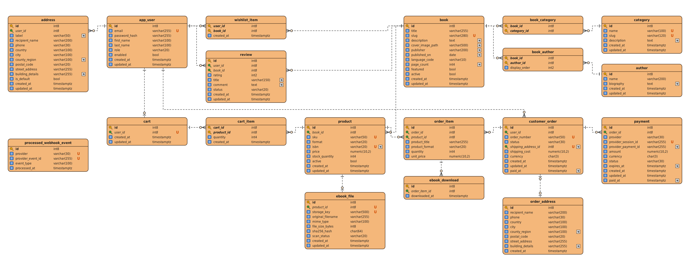

# Bookora database

PostgreSQL 18, **21 tables** in **third normal form (3NF)**, created and changed only through Flyway migrations in
[`backend/src/main/resources/db/migration`](../../backend/src/main/resources/db/migration). Hibernate only validates the
schema (`ddl-auto=validate`); it never changes it.

The diagram shows the 19 tables of the first schema (`V1__init.sql`). Two tables were added later and are described
below: `contact_message` (V4, V7) and `book_image` (V8).

## Tables

### Users

| Table      | Purpose                                                                                                   |
| ---------- | --------------------------------------------------------------------------------------------------------- |
| `app_user` | Account: unique email, BCrypt password hash, name, role (`CUSTOMER` or `ADMIN`), enabled flag.             |
| `address`  | Delivery addresses saved by a customer; one of them is the default. Deleted together with the account.    |

### Catalog

| Table           | Purpose                                                                                                    |
| --------------- | ---------------------------------------------------------------------------------------------------------- |
| `book`          | One catalog entry: title, unique slug for the address bar, description, publisher, cover, featured, active. |
| `author`        | A person who wrote books.                                                                                  |
| `book_author`   | Which authors wrote which book, with their display order (many to many).                                    |
| `category`      | A genre with a unique name and slug.                                                                       |
| `book_category` | Which categories a book belongs to (many to many).                                                         |
| `book_image`    | The pictures of a book in order; position 0 is the cover. *(V8)*                                           |
| `product`       | A format of a book (paperback, hardcover, PDF, EPUB) with its own SKU, ISBN, price, stock and active flag.   |
| `ebook_file`    | The file of a PDF or EPUB product: random storage key, SHA-256, size, type and scan status.                |

### Customer activity

| Table             | Purpose                                                                                 |
| ----------------- | --------------------------------------------------------------------------------------- |
| `review`          | A rating from 1 to 5 with an optional title and comment; `PENDING` until an admin decides. |
| `wishlist_item`   | A book a customer saved for later (key: user and book).                                 |
| `cart`            | The cart of a signed-in customer (one per user).                                        |
| `cart_item`       | A product and its quantity in a cart (key: cart and product).                           |
| `contact_message` | A message sent from the contact form and whether an admin handled it. *(V4, V7)*        |

### Orders and payments

| Table                     | Purpose                                                                                       |
| ------------------------- | --------------------------------------------------------------------------------------------- |
| `customer_order`          | An order: unique number, status, delivery cost, currency, dates.                              |
| `order_address`           | A copy of the delivery address taken when the order was placed.                              |
| `order_item`              | A line of an order, with the title, format and price copied from the product at that moment. |
| `payment`                 | A Stripe Checkout session for an order and its result.                                       |
| `ebook_download`          | One row each time a customer downloads a paid e-book.                                        |
| `processed_webhook_event` | Stripe events already handled, so a repeated event changes nothing.                          |

## Why it is in 3NF

- Every table has a single key, and every other column depends on the whole key and only on it.
- Data shared by all formats of a book (authors, categories, description, reviews) lives on `book`; what differs per format
  (price, stock, ISBN) lives on `product`. Nothing is repeated between them.
- Many-to-many relations (`book_author`, `book_category`, `wishlist_item`, `cart_item`) have their own tables with
  composite keys.
- Totals and ratings are not stored. The views `order_total_view` and `book_rating_view` compute them, so they can never
  disagree with the rows they come from.
- `order_item` and `order_address` copy titles, prices and the address on purpose: they record what the customer bought
  and where it was sent, which must not change when the catalog or a saved address changes later. This is history, not
  duplication.

## Rules the database enforces

- Unique email, slug, SKU, ISBN, order number, Stripe session id, storage key and webhook event.
- Ratings between 1 and 5; prices, stock and delivery cost never negative; page count above 0.
- E-books (`PDF`, `EPUB`) always have a stock of 0, and a book has at most one product per format.
- One review per customer and book, one cart per customer, one file per e-book product.
- At most one successful payment per order (a partial unique index on `payment`).
- Statuses, roles, formats and scan results are limited to known values with `CHECK` constraints.

## Migrations

| Version | Change                                                                                     |
| ------- | ------------------------------------------------------------------------------------------ |
| V1      | The whole schema and the two views.                                                        |
| V2, V3  | The first eight books, eight categories and their descriptions.                            |
| V4, V7  | Contact messages, and whether they were handled.                                           |
| V5      | The sequence for order numbers.                                                            |
| V6      | Prices moved from RON to EUR.                                                              |
| V8      | Several pictures per book.                                                                 |
| V9      | Demo catalog: 36 more books, hardcover and PDF editions.                                    |
| V10     | Demo customers, addresses, orders, payments, downloads, reviews, wishlists, carts, messages. |
